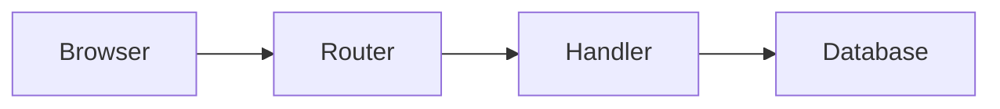

Start with the defaults. Each change below is one option in `nuxt.config.ts`, one frontmatter field, or one component. The [Server API](/docs/docs-site/server-api) lists every option and field.

## Organize the content

```txt
content/
  index.md                  /
  about.md                  /about
  docs/
    index.md                /docs
    guide/
      .navigation.yml       section title, icon, order, category, group, fold
      index.md              /docs/guide
      install.md            /docs/guide/install
      deploy/
        index.md            /docs/guide/deploy
```

- Each folder in `content/docs/` is a section: one rail entry and one sidebar page list. A site with three sections or fewer, or no section icons, has no rail; its sidebar lists every section with its pages.
- `index.md` is its folder's page. `content/docs/index.md` is the page at `/docs`. Without it, `/docs` is not found and the Docs links open the first section.
- Files outside `content/docs/`, such as `about.md`, are plain articles under the site header, with no sidebar.
- A page's URL is its path in the folder. Without a `content/docs/` folder, the docs are the whole site: `content/index.md` is `/`, and each folder in `content/` is a section.
- `dir` changes the content folder, and `base` sets the URL prefix of the sections when the default does not fit.
- In an app with its own pages, put the docs in `content/docs/` only. See [Add docs to a Nuxt app](/docs/docs-site/nuxt-app).

### Sections and categories

`.navigation.yml` names the section and places it:

```yaml [content/docs/guide/.navigation.yml]
title: Guide
icon: i-lucide-book-open
order: 1
category: Learn
related: [reference]
```

`order` sorts sections in the rail, `category` groups them, and `related` lists other section ids under Related in the sidebar.

`categories` sets the category order. The rail shows one group per category, and the catalog at the end of each Overview lists every category in `categories`. `railExclude` keeps a category in the catalog but out of the rail, for example shared reference pages.

```ts [nuxt.config.ts]
export default defineNuxtConfig({
  modules: ['@vite-hub/docs/nuxt'],
  docs: {
    categories: ['Learn', 'Build', 'Reference'],
    railExclude: ['Reference'],
    // The section that new readers open first, and site pages at the top of it
    start: { section: 'guide', links: [{ label: 'All docs', to: '/docs', icon: 'i-lucide-layout-grid' }] },
  },
})
```

A section with no category, or one that `categories` does not list, shows in a last rail group and not in the catalog.

### Groups

A library with one section per package can have more sections than the rail can show. A group puts several sections in one rail item. The item opens the group's first section. Each member's sidebar lists all sections of the group: one row per section that opens its home page, followed by its other pages. When the sections have different categories, the sidebar shows each category as a heading.

List the sections in `groups`, or set `group` in their `.navigation.yml`:

```ts [nuxt.config.ts]
export default defineNuxtConfig({
  modules: ['@vite-hub/docs/nuxt'],
  docs: {
    groups: [
      { title: 'Components', icon: 'i-lucide-blocks', sections: ['tabs', 'steps', 'cards'] },
    ],
  },
})
```

```yaml [content/docs/charts/.navigation.yml]
title: Charts
icon: i-lucide-chart-line
category: Data blocks
group: Components
```

The group takes its first section's place in the rail, and its sections keep their `order`. A group without an `icon` uses its first section's icon. A `group` that `groups` does not list still forms a group with that title. A group counts as one item when the shell decides whether the site needs a rail.

### Pages in the sidebar

`navigation.order` sorts a section's pages after its Overview. `navigation.group` puts pages under a label. `navigation.title` is a shorter label than `title`. `navigation: false` hides a page from the sidebar, but the page still renders at its URL.

```md [content/docs/guide/deploy/index.md]
---
title: Deploy Lumen in CI
navigation.title: Deploy
navigation.group: Operate
navigation.order: 4
---
```

### Fold page groups

A section with many pages, such as one per lint rule, can fold its page groups. Set `fold: true` in its `.navigation.yml`:

```yaml [content/docs/rules/.navigation.yml]
title: Rules
icon: i-lucide-stethoscope
fold: true
```

Each group with a heading starts closed. The reader opens it with a click, Enter, or Space. The group with the current page opens itself, so its link stays visible. Pages without a group stay open. A [group of sections](#groups) folds the page groups of each section that sets `fold`.

### Panels

A long list of pages, such as one page for each error code, would bury the other pages of a section. Set `navigation.panel: true` on the `index.md` of a folder inside the section, and the folder becomes a panel:

```md [content/docs/queue/diagnostics/index.md]
---
title: Queue diagnostics
navigation.title: Diagnostics
navigation.panel: true
---
```

- The section sidebar shows one link to the panel, with the number of its pages, after the section pages.
- On a page of the panel, the sidebar lists only the panel: a link back to the section, the panel Overview, and its pages by `navigation.group`. Each group folds. A page title that is a code, such as `QUEUE_DISABLED`, shows in monospace on one line.
- The rail keeps the reader in the panel. On `/docs/queue/diagnostics/queue_disabled`, the KV item opens `/docs/kv/diagnostics` when that folder is a panel too, and `/docs/kv` when it is not.
- Previous and next stay inside the panel.

### Pages that search engines skip

Set `seo.index: false` on a page that search engines must not index, such as one page in a long tail of generated pages:

```md [content/docs/queue/diagnostics/queue_disabled.md]
---
title: QUEUE_DISABLED
description: Queue is disabled.
seo.index: false
---
```

The page gets `<meta name="robots" content="noindex, follow">` and stays out of `sitemap.xml`, llms.txt, `llms-full.txt`, and the share images. The site search lists it by its title and description only. The build does not prerender it; the server renders it on request, so thousands of generated pages do not slow the build. Links to the page stay valid for the link checker, and its Markdown copy stays at `/raw/...`. Keep the page that lists these pages indexed.

### Moved pages

When a page moves, keep its old URL with a `redirect` route rule:

```ts [nuxt.config.ts]
export default defineNuxtConfig({
  modules: ['@vite-hub/docs/nuxt'],
  routeRules: {
    '/docs/guide/setup': { redirect: { to: '/docs/guide/install', status: 301 } },
  },
})
```

The link checker accepts links to the old URL. Instead, a production build checks the rule. It stops with [`DocsRedirectError`](/docs/docs-site/limits-and-errors#docsredirecterror) when the rule leads to a docs URL that no page answers, or starts at a page that still exists. Rules from other modules count too. Wildcard rules, such as `/docs/old/**`, are not checked this way.

Rules added in a module's `nitro:config` hook are also checked, and keep the link checker's own redirect warnings.

### Taglines, credits, and keywords

```md [content/docs/icons/index.md]
---
title: Icons
description: Icon components for Lumen pages.
tagline: Every Lucide icon as a Markdown block.
eyebrow: comark-icon
credits: Icons from [Lucide](https://lucide.dev).
keywords: glyph, symbol, svg
---
```

- `tagline` replaces `description` under the heading. `description` stays the meta description and the llms.txt entry.
- `eyebrow` is a short label above the title.
- `credits` is one line of inline Markdown at the page end.
- `keywords` find the page in search for words the page does not contain. A keyword match ranks like a heading, below the title.

## Layouts

Set `layout` in the frontmatter:

| Layout | Use it for | Shows |
| --- | --- | --- |
| `article` (default) | Guides, concepts, and reference pages | Title, description, text, and outline. |
| `tutorial` | Steps that build one result | Numbered `::tutorial-step` blocks. With `codePanel: true`, a code panel beside the text. |
| `landing` | Section Overviews | A wide page with no outline, ending with the catalog of every section. |
| `home` | A product home page | Only the page's own blocks, full width under the site header, with no docs sidebar. |

### Tutorials

Put each step in a `::tutorial-step` block. Steps are numbered in order:

````md [content/docs/guide/first-image.md]
---
title: Compress your first image
layout: tutorial
codePanel: true
---

::tutorial-step{title="Write the config"}
## Write the config

```json [lumen.config.json]
{ "quality": 75 }
```
::
````

With `codePanel: true`, wide screens show a sticky panel beside the text. It lists every file the reader has passed and shows the current step's file. Name each code block with its path. Blocks named `commands/...` or `output/...`, and `bash` or `sh` blocks, stay in the text, because they are commands, not project files. The panel tracks files by name, so give each file one name in the whole tutorial.

`tutorial: project` or `tutorial: quickstart` is stored in the manifest for your components, such as a tutorials catalog. The shell ignores it.

### Landing pages

A `landing` page has no outline by default. For a list of linked features, use `::product-features` with `:::product-feature-item` blocks:

```md [content/docs/guide/index.md]
---
title: Guide
layout: landing
---

::product-features
  :::product-feature-item{title="Compress a folder" icon="i-lucide-image" to="/docs/guide/install"}
  One command for every image in a folder.
  :::
::
```

## Navigation and outline

The left navigation and right outline show on every docs page. To hide them on one page:

| Field | Default | Effect of `false` |
| --- | --- | --- |
| `sidebar` | `true` | Hides the left navigation: section rail and page sidebar. |
| `toc` | `true`, and `false` on `landing` pages | Hides the "On this page" outline. |

```md [content/docs/guide/changelog.md]
---
title: Changelog
sidebar: false
toc: false
---
```

### Collapsed navigation

A page that needs the width, such as a playground, can start with the navigation collapsed. Set `sidebar: collapsed` in the frontmatter. On wide screens the navigation becomes a narrow column with the logo, an open button, search, and the site links. A site with a rail keeps the rail in that column. The reader opens and collapses the navigation with the same button, and a cookie keeps the choice on every page that starts collapsed. A tutorial with `codePanel: true` starts collapsed too.

An app page in the docs layout sets the same in its page meta:

```vue [app/pages/playground.vue]
<script setup lang="ts">
definePageMeta({ layout: "docs", sidebar: "collapsed" })
</script>
```

Pages with a collapsible navigation fill the viewport, so they leave out the `banner`.

## Site options

```ts [nuxt.config.ts]
export default defineNuxtConfig({
  modules: ['@vite-hub/docs/nuxt'],
  docs: {
    site: {
      name: 'Lumen',
      url: 'https://lumen.example.com',
      description: 'Resize and compress images from the command line.',
      // A one-color SVG in public/. The design fills it with the text color.
      // A colored logo shows as it is: logo: { light: '/lumen.svg', dark: '/lumen-dark.svg' }.
      logo: '/lumen-mark.svg',
      badge: { label: 'beta', tooltip: 'The CLI flags can change.' },
    },
    banner: 'Lumen 2 is out. Read the upgrade guide.',
    github: { repo: 'acme/lumen' },
    socials: [{ label: 'Lumen on Discord', to: 'https://discord.gg/lumen', icon: 'i-simple-icons-discord' }],
    footer: [{ label: 'About', to: '/about' }, { label: 'Privacy', to: '/privacy' }],
  },
})
```

The docs sidebar starts with the brand and search. At its foot, `github` adds a GitHub link with the star count when available. `socials` adds community links, followed by the color mode button. Other pages and phones show these controls in the header. `footer` links site pages, such as About and Privacy, at the end of every docs page. `banner` shows one line above every docs page.

## Design

The design follows the comark-ui site: Geist, neutral grays, hairline rings, small radii, a faint page grain, and GitHub code colors. The docs sidebar holds the brand, search, and a rail of sections or groups next to the page list. Links sit at its foot. Text, code, and focus rings pass WCAG AA in light and dark mode. Change it in two places:

- `app.config.ts`: Nuxt UI `ui` keys. Your values beat the design, and the design beats the Nuxt UI defaults, even when `@nuxt/ui` comes first in `modules`.
- CSS variables in your app stylesheet:

```css [app/assets/main.css]
:root {
  /* The reading width of prose */
  --vh-content-width: 50rem;
  --vh-toc-width: 14rem;
  --font-sans: "Inter", ui-sans-serif, system-ui, sans-serif;
}
```

`--vh-panel-width` sets the page sidebar width, `--vh-grain: none` turns off the grain, and the Nuxt UI `--ui-*` variables set colors.

In an app with its own `app.vue`, the design applies to the docs pages only, and the app's `app.config.ts` stays as written. The docs pages then use the app's Nuxt UI colors. To set a variable on the docs pages only, use the `:root.vh-docs` selector. See [Add docs to a Nuxt app](/docs/docs-site/nuxt-app#what-the-module-changes-in-your-app).

### Icons

The shell uses Lucide, Simple Icons, and VS Code Icons. Install `@iconify-json/lucide`, `@iconify-json/simple-icons`, and `@iconify-json/vscode-icons` to serve them from your app. Without them, `@nuxt/icon` gets them from the Iconify API.

The ViteHub icon set is registered: write `i-vitehub-<name>`, such as `icon: i-vitehub-kv` in a `.navigation.yml` file. The rail draws these icons inline and animates them on hover. The [`@vite-hub/icons`](https://github.com/vite-hub/vitehub/tree/main/packages/icons) README lists every name.

`icons` sets the navigation icons:

| Key | Use |
| --- | --- |
| `rail` | Rail icon per section id, such as `i-vitehub-reference`. Replaces the section icon in the rail only. |
| `sections`, `pages` | Sidebar icon per section id or page path. Replaces the icon in the file. |
| `aliases` | Replacement per icon name, so the sidebar keeps one icon style. |
| `family` | Icon prefix of the sidebar, such as `i-lucide-`, or a list of prefixes. Other icons that `aliases` does not map show the fallback. |
| `page`, `section` | Fallback icons. |
| `stroke` | Stroke width of Lucide icons. The default `1.5` matches the ViteHub set. `false` keeps Lucide's 2px. |

## Replace a component

The shell is a set of Nuxt components. Add a component with the same name to your app, and the shell uses yours. This file replaces the page actions:

```vue [app/components/DocsPageHeaderLinks.vue]
<script setup lang="ts">
const found = useDocsPage()
const { github } = useDocsConfig()
</script>

<template>
  <UButton
    v-if="found && github"
    :to="`${github.url}/blob/${github.branch}/${github.dir}/${found.page.file}`"
    label="Edit on GitHub"
    variant="ghost"
  />
</template>
```

| Component | Part of the shell |
| --- | --- |
| `AppHeader` | The site header, with search, GitHub, social links, and the color mode button. On wide screens it hides beside the docs sidebar. |
| `AppSearch` | The search dialog. |
| `DocsRail` | The section rail. |
| `DocsSidebars`, `DocsAsideLeftTop`, `DocsAsideLeftBody`, `DocsAsideFooter` | The page sidebar and its parts: the brand and search, the page list, and the row of links. |
| `DocsPage` | Picks a page's layout. |
| `DocsArticle`, `DocsLanding` | The `article` and `tutorial` layouts, and the `landing` layout. |
| `DocsMarkdown`, `DocsCodePre` | The rendered Markdown and its code blocks. |
| `DocsCodePanel` | The tutorial code panel. |
| `DocsPageHeaderLinks` | Copy page, View as Markdown, Open in ChatGPT or Claude, and the MCP links. |
| `DocsPageCredits` | The `credits` line at the end of a page. |
| `DocsCatalogFooter` | The catalog at the end of an Overview. |

The app can also replace `app.vue`, `error.vue`, the `docs` and `default` layouts, and the catch-all page; the module adds its own only when the app has none. A catch-all page replaces the docs page only when it answers every docs page, such as `pages/[...slug].vue`. One in another folder, such as `pages/blog/[...slug].vue`, does not.

Components read the site through auto-imported composables:

| Composable | Returns |
| --- | --- |
| `useDocsConfig()` | The `docs` options, with every default filled. |
| `useDocsManifest()` | Every section and page. A page has its navigation fields, `title`, `sourceTitle`, `description`, and `layout`. The page route returns the rest, such as `seo` and `credits`. |
| `useDocsPage()` | The current route's page and section, or `null`. |
| `useDocsSection()` | The current route's section. |
| `useDocsIcons()` | The icon of a page, section, or rail entry, after the `icons` option. |
| `useDocsAssistant()` | The [assistant](/docs/docs-site/assistant) panel state, and `toggle()`. |

## Add a Markdown block

A Markdown block such as `::tutorial-step` is a component in `components/content/`. Add your own in `app/components/content/`. `Callout.vue` becomes the `::callout` block. Block attributes are its props, and the block content is its slot.

```vue [app/components/content/Callout.vue]
<script setup lang="ts">
defineProps<{ title?: string }>()
</script>

<template>
  <aside class="not-prose border border-default p-4">
    <p v-if="title" class="font-medium">{{ title }}</p>
    <slot />
  </aside>
</template>
```

```md [content/docs/guide/install.md]
::callout{title="Node.js 22"}
Lumen does not run on Node.js 22 or older.
::
```

The package has `::tutorial-step`, `::product-features`, `:::product-feature-item`, `::agent-only`, and `::examples` with `:::example`, which show rendered Markdown next to its source. Every page also renders [comark-ui](https://comark-ui.onmax.me)'s blocks: callouts, tabs and code groups, steps, code with a copy bar, zoomable images, charts, Mermaid diagrams, file trees, cards, annotated screenshots, diffs, quizzes, and comments.

An example shows the first fenced block inside it, rendered with the page's plugins, and its source behind a Code switch:

````md [content/docs/guide/callouts.md]
::examples
:::example{label="Note"}
```md
> [!NOTE]
> Lumen caches every page for an hour.
```
:::
::
````

### Diagrams

A `mermaid` fence becomes a diagram. The server draws it as an SVG with [Pele](https://pele.run), so the page shows the diagram before any script runs, and the source does not leave your server:

````md [content/docs/guide/requests.md]

````


D2, PlantUML, and Graphviz fences stay code blocks. comark-ui draws them through a [Kroki](https://kroki.io) server, which receives the source of each diagram. To accept that, set `comarkUi: { diagrams: true }` in the [parser options](#configure-the-parser) for kroki.io, or `comarkUi: { diagrams: { server: 'https://kroki.example.com' } }` for your own Kroki server.

### Configure the parser

The server parses every page with [Comark](https://comark.dev) and comark-ui's plugins. Plugins are functions, so the parser options go in a module that `parser` names, not in `nuxt.config.ts` itself:

```ts [docs.parser.ts]
import type { DocsParserOptions } from '@vite-hub/docs/server'
import emoji from 'comark/plugins/emoji'

export default {
  plugins: [emoji()],
  comarkUi: { chips: true },
  examples: { play: source => `/play#md=${encodeURIComponent(source)}` },
} satisfies DocsParserOptions
```

```ts [nuxt.config.ts]
export default defineNuxtConfig({
  modules: ['@vite-hub/docs/nuxt'],
  docs: { parser: './docs.parser.ts' },
})
```

The page route, search, and Console drafts parse with these options:

- `comarkUi` sets comark-ui's options, merged over the built-in ones: typeset, chips, Kroki diagrams, and badge downloads are off. `{ chips: true }` turns every web link into a chip with its favicon. With `docs.github` set, `#123` in a page links to an issue in that repository.
- `examples.tags` names the blocks that get a preview, `['example', 'correct', 'incorrect']` by default. `examples.play(source, tag)` returns a playground URL for an example's Markdown, and the example links to it. Return `undefined` for no link.
- `plugins` adds more Comark plugins after the built-in ones. A plugin with the name of a built-in plugin, such as `alert` or `comark-tabs`, replaces it. The browser receives the parsed nodes, so a plugin that adds a tag needs a component for it in `app/components/content/`.

## Agent resources

Coding agents read the same pages without HTML. These routes need no setup:

| Route | Content |
| --- | --- |
| `/raw/<page>.md` | The page as Markdown, with its title as a heading and absolute links. |
| `/llms.txt` | An index of every page with its description. |
| `/llms-full.txt` | Every page in one file. |
| `/sitemap.md` | Every page, for agents. `/sitemap.xml` is the same list for search engines. |
| `/mcp` | An MCP server with the `list-pages` and `get-page` tools. |
| `/.well-known/skills/<name>/SKILL.md` | Each Agent Skill in the app's `skills/` folder. |

Each page header has **Copy page**, **View as Markdown**, **Open in ChatGPT**, **Open in Claude**, and links that add the MCP server to Cursor or VS Code. `mcp: { name, guide }` sets the server name and a page on connecting other tools. `mcp: false` turns the server off.

[Content](/docs/content/seo#markdown-for-agents) serves these files from the same pages as the site, so a new page shows in each of them. `llms` adds text to `/llms.txt`: `details` goes under the site description, and `sections` adds sections of links before the page sections.

```ts [nuxt.config.ts]
export default defineNuxtConfig({
  modules: ['@vite-hub/docs/nuxt'],
  docs: {
    llms: {
      details: 'Rules for coding agents: read the installed types before you write code.',
      sections: [{ title: 'Machine resources', links: [{ title: 'OpenAPI document', href: 'https://docs.example.com/openapi.json' }] }],
    },
  },
})
```

### Content only for agents

```md [content/docs/guide/ci.md]
::agent-only
Run `lumen check ./public --max-size 300kb` after the build. Exit code 1 means an image is too large.
::
```

The site renders nothing for `::agent-only`, and search skips it. The Markdown copy, llms-full.txt, and the MCP server keep it. Use it for CLI versions of UI steps and common agent mistakes, not for content people need too.

### Rewrite the agent copy

When a page uses a component with no Markdown form, `rawMarkdown` rewrites the page before its copy is made. It gets the Markdown and the page, and runs at build time, before the built-in rewrites. The server keeps each page that it changed. This one turns a `::demo-video{src="..."}` block into a link:

```ts [nuxt.config.ts]
export default defineNuxtConfig({
  modules: ['@vite-hub/docs/nuxt'],
  docs: {
    rawMarkdown: markdown => markdown.replace(/::demo-video\{src="([^"]+)"\}\n::/g, '[Watch the demo]($1)'),
  },
})
```

## Search

`⌘K` opens search. It finds text under each `h2` and `h3` heading of every page. The index loads from `/api/_docs/search.json` when the dialog first opens. It skips agent-only content.

## Comments

A docs site on `vite-hub/nuxt` has [Comments](/docs/comments) on every page. Your team pins comments, replies, mentions each other, and resolves threads. Install the package:

```sh [commands/comments]
pnpm add @vite-hub/comments
```

```ts [nuxt.config.ts]
export default defineNuxtConfig({
  modules: [
    ['vite-hub/nuxt', { preset: 'node', console: { auth: false } }],
    '@vite-hub/docs/nuxt',
  ],
})
```

The docs module turns on `vite-hub/nuxt`'s `comments` option, which turns on the Database. Create the tables once with `vitehub database generate` and `vitehub database migrate`. `server/comments.ts` is optional; add it to set `authorize`, `people`, or `onMention`. See [Configure Comments](/docs/comments/configure).

- **Each page has its own threads.** A thread belongs to the page path, such as `/docs/kv`. A deploy keeps threads on their page. A renamed page starts with none.
- **Readers see nothing.** The page loads the overlay only with `?vitehub` or the `vitehub-tools` cookie, and only for people `authorize` lets read. Without `authorize`, a production build admits GitHub users who can push to the repository. Signed-out readers get no toolbar. With no Console and no Auth, but GitHub sign-in set up, `?vitehub` shows **Sign in with GitHub**. The development server lets everyone comment.
- **`@` lists your people.** With [Auth](/docs/auth), it suggests Auth users who may read the thread. Without Auth, it suggests people who wrote in threads you can read.
- **The Console lists the threads.** Open the app in the [Console](/docs/development/console) and select **Comments** to see every thread with its page.

`comments: false` turns Comments off, and sets `comments: false` on `vite-hub/nuxt`. To change the Database or leave the overlay out of the pages, pass `vite-hub/nuxt`'s `comments` options:

```ts [nuxt.config.ts]
export default defineNuxtConfig({
  docs: {
    // Or `comments: false`.
    comments: { database: 'docs', overlay: false },
  },
})
```

A site without `vite-hub/nuxt` has no server for threads, so it has no Comments. Setting `comments` to `true` or an object there stops the build with [`DocsCommentsSetupError`](/docs/docs-site/limits-and-errors#docscommentssetuperror).

## Edit in the Console

The ViteHub Console edits and publishes docs pages through the [CMS](/docs/cms). The site still renders the Markdown files. The CMS stores and publishes drafts.

Install `vite-hub/nuxt` next to `@vite-hub/docs/nuxt` and add one file:

```ts [server/content.ts]
import { defineContent } from 'vite-hub/content'
import cms from 'vite-hub/cms'
import { docsCollection } from '@vite-hub/docs'

export default defineContent({
  extends: [cms, { repo: 'owner/name', publish: 'pr', access: 'roles' }],
  collections: { docs: docsCollection() },
})
```

Open the app in the [Console](/docs/development/console), select **Content**, then **Docs**. The build reads this file without running it, so keep `defineContent({ extends, collections })` as written and give `cms` options as string literals. Leave out the Content `seo` option. The docs module already serves the sitemap and each page's Markdown copy, and Content's `.md` copies would compete in another format.

`docsCollection()` is a `documents()` collection over the pages:

- `path` defaults to `content/**/*.md`. The folder before the first `*` must be the content folder, because the document id is the page file without `.md`. In a monorepo, pass `docsCollection({ path: 'docs/content/**/*.md' })`.
- `fields` are the page frontmatter. The Console validates them like the build and writes dotted keys such as `navigation.order` back as dotted keys.
- Each document URL is its page URL: `content/docs/kv/index.md` is `/docs/kv`, and `content/about.md` is `/about`.

With `repo`, the CMS uses the GitHub store and needs `VITEHUB_GITHUB_TOKEN`. A save commits to the `vitehub/content` branch, and `publish: 'pr'` opens a pull request into `main`. The site shows the change after the pull request merges and the site rebuilds.

Without `repo`, the CMS uses the Blob + Database store. Its Workspace starts empty, and a publish does not change the files the site renders, so use it only to try the editor. Run `vitehub database generate` and `vitehub database migrate` once, then import a page with `vitehub content edit docs docs/kv/index --file content/docs/kv/index.md`.

`access: 'roles'` uses the CMS roles of the Better Auth `admin` plugin. Your own `authorize` replaces it. For example, `authorize: () => import.meta.dev` lets everyone edit in development and nobody in production.

The page route can render a draft: it reads the draft from the collection and parses it like a published page, with `Cache-Control: private, no-store`. Draft-only pages preview too. The sidebar, search, and previous and next links stay published. The preview needs a server that renders the page; a prerendered page on a static host shows the published file. Without `server/content.ts`, the page route reads only the files and bundles nothing from Content.
